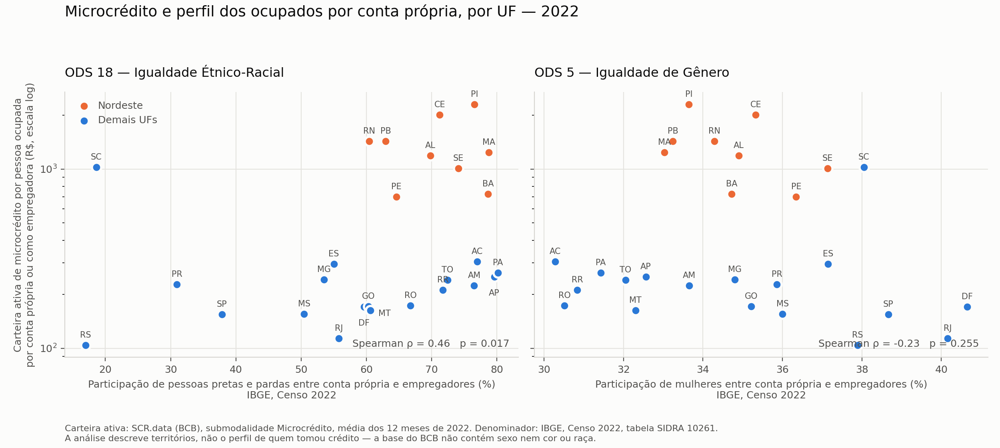

# Microcrédito, gênero e raça: análise territorial — ODS 5 e ODS 18

Tema 05 — Acesso a Microcrédito e Inclusão Financeira Regional.
Execução da decisão **D-16** (`docs/DECISOES_TECNICAS.md`). Análise feita em **05/11/2026**.

---

## Antes de qualquer número: o que esta análise é e o que ela não é

A base de microcrédito do SCR.data **não contém sexo, gênero, cor ou raça**. Nenhum
atributo demográfico foi imputado a nenhuma operação de crédito, e não há junção entre
pessoas: o grão mínimo dos nossos dados é um agregado de UF × tipo de cliente × modalidade
× mês.

O que se faz aqui é comparar **dois indicadores territoriais**: o volume de microcrédito por
UF, que vem do Banco Central, e o perfil demográfico de quem trabalha por conta própria ou
como empregador na mesma UF, que vem do IBGE. A unidade de análise é **a UF**, não a pessoa.

> **Ressalva obrigatória.** Concluir algo sobre indivíduos a partir de médias territoriais é
> **falácia ecológica**. Se uma UF com muitas pessoas pretas e pardas tem muito microcrédito,
> isso **não** significa que pessoas pretas e pardas tomaram esse crédito. Esta análise
> descreve territórios, não tomadores.

Essa ressalva deve aparecer no relatório e no dashboard, nestes termos.

---

## Método

**Indicador de microcrédito (nosso banco).** Para cada UF, a carteira ativa média mensal de
2022 — a média dos 12 meses, porque carteira é estoque e somar estoques mensais não
significa nada (decisão D-12). A taxa de inadimplência por UF é **ponderada pela carteira**,
nunca média simples das taxas (decisão D-09). Soma PF e PJ.

**Indicador demográfico (IBGE).** Censo Demográfico 2022, Amostra — Trabalho e Rendimento,
**tabela SIDRA 10261**, variável 4090, nível N3 (UF). Recorte: pessoas de 14 anos ou mais
ocupadas como **empregador com pelo menos um empregado** (categoria 79377) ou **conta
própria sem empregados** (categoria 79378). Desse recorte saem duas participações por UF:
de mulheres, e de pessoas pretas e pardas somadas.

**Normalização.** A carteira é dividida pelo número de ocupados por conta própria e
empregadores da UF, para não medir apenas o tamanho da economia estadual. O resultado é
"reais de carteira ativa por pessoa ocupada por conta própria ou como empregadora".

**Estatística.** Correlação de postos de Spearman, escolhida porque a carteira per capita é
muito assimétrica (de R$ 104 a R$ 2.297). Com **n = 27**, o poder estatístico é baixo: os
valores-p servem para calibrar a leitura, não para decidir nada.

Ano de referência: 2022, o ano do Censo, para que numerador e denominador sejam
contemporâneos. Julho de 2026, o último mês disponível, entra como checagem de robustez.

Reprodução: `python analise/ods_cruzamento.py`.

---

## Resultados

### Correlações (Spearman, n = 27 UFs)

| Relação | ρ | p |
|---|---:|---:|
| **ODS 5** — mulheres × carteira per capita (2022) | −0,227 | 0,255 |
| **ODS 5** — mulheres × inadimplência (2022) | 0,133 | 0,508 |
| **ODS 18** — pretas e pardas × carteira per capita (2022) | **0,455** | **0,017** |
| **ODS 18** — pretas e pardas × inadimplência (2022) | −0,218 | 0,275 |
| *controle* — carteira per capita × inadimplência (2022) | **−0,871** | **<0,0001** |
| *robustez* — mulheres × carteira per capita (jul/2026) | −0,155 | 0,440 |
| *robustez* — pretas e pardas × carteira per capita (jul/2026) | 0,370 | 0,058 |

### Medianas por região (2022)

| Região | UFs | Carteira por ocupado | Inadimplência | Mulheres | Pretas e pardas |
|---|---:|---:|---:|---:|---:|
| Nordeste | 9 | R$ 1.236 | 6,1% | 34,7% | 71,2% |
| Norte | 7 | R$ 240 | 12,8% | 31,4% | 76,5% |
| Sul | 3 | R$ 228 | 11,5% | 37,9% | 18,6% |
| Sudeste | 4 | R$ 198 | 12,9% | 37,9% | 54,3% |
| Centro-Oeste | 4 | R$ 167 | 14,5% | 35,6% | 60,0% |

Tabela completa por UF: `docs/evidencias/ods_cruzamento_uf.csv`.

---

## Leitura dos resultados

### ODS 18 — há associação territorial, mas ela não é sobre raça

A correlação é positiva e significativa a 5%: UFs com maior participação de pessoas pretas
e pardas entre conta própria e empregadores têm **mais** carteira de microcrédito por
ocupado, não menos.

Antes de celebrar isso como inclusão, vale testar a explicação concorrente mais óbvia — e
ela se confirma. **As 9 UFs do Nordeste concentram 62,1% de toda a carteira de microcrédito
do país em 2022**, com mediana de R$ 1.236 por ocupado contra R$ 167 a R$ 240 nas demais
regiões. O Nordeste também é a região com alta participação de pessoas pretas e pardas
(mediana 71,2%). Ou seja, as duas variáveis sobem juntas porque o Nordeste é alto nas duas.

Excluindo o Nordeste, a correlação **perde significância**: ρ = 0,358 com p = 0,145 (n = 18).

A leitura honesta: o que a correlação capta é **onde a oferta de microcrédito está
concentrada**, não o acesso de um grupo racial. A concentração regional é compatível com a
existência de programas de microcrédito de alcance regional, mas essa explicação é
**hipótese**, não resultado — nossa base não identifica instituição financeira nem programa,
e testá-la exigiria outra fonte.

Há contraexemplos claros no gráfico. **Santa Catarina** tem a segunda menor participação de
pessoas pretas e pardas do país (18,6%) e mesmo assim R$ 1.023 de carteira por ocupado,
9,9% do total nacional. **Rio de Janeiro** tem 55,8% de pretas e pardas e apenas R$ 113 por
ocupado, uma das menores do país. A relação está longe de ser determinística.

### ODS 5 — não há associação detectável

A correlação com a participação de mulheres é fraca, negativa e não significativa
(ρ = −0,227, p = 0,255), e continua assim em julho de 2026. Excluindo o Nordeste ela fica
em −0,410 com p = 0,091 — ainda não significativa a 5%, e com n = 18.

**Isso é um resultado, não uma falha.** A conclusão correta é: *com estes dados, no nível de
UF, não há evidência de associação entre a presença de mulheres entre pequenos
empreendedores e o volume de microcrédito do estado.* O que não se pode dizer é que não
existe desigualdade de gênero no acesso — a base simplesmente não permite observá-la,
porque não tem sexo. Ausência de evidência aqui é consequência do desenho da fonte.

Note também que a variação entre UFs é pequena nesse indicador: a participação de mulheres
vai de 31,4% (Acre) a 40,6% (Distrito Federal), uma faixa estreita se comparada à de
pretas e pardas, que vai de 17,0% a 80,2%. Faixa estreita dificulta detectar qualquer
relação.

### O achado mais forte não é sobre nenhum dos dois ODS

A relação mais nítida de toda a análise é entre **densidade de microcrédito e
inadimplência**: ρ = −0,871, p < 0,0001. Onde há mais microcrédito por ocupado, a
inadimplência é muito menor — Piauí tem R$ 2.297 por ocupado e 5,9% de inadimplência,
enquanto Rio de Janeiro tem R$ 113 e 22,4%.

Isso merece cautela na interpretação. Pode significar que operações de microcrédito feitas
em escala, com metodologia própria, inadimplem menos; pode significar que carteiras
pequenas são residuais e concentram casos problemáticos; pode ser as duas coisas. A
correlação é forte, a explicação não está nos dados.

---

## Limitações desta análise

1. **Falácia ecológica.** Repetida no topo por ser a mais importante.
2. **Universos diferentes.** A carteira soma PF e PJ; o denominador do IBGE conta pessoas
   ocupadas por conta própria ou como empregadoras. São universos próximos, não idênticos —
   o denominador é um normalizador razoável, não a população exata dos tomadores.
3. **n = 27.** Poder estatístico baixo. Uma UF atípica move o resultado.
4. **Um único ano no Censo.** A tabela 10261 só existe para 2022; não dá para acompanhar
   mudança no perfil demográfico ao longo do período. Para série temporal por sexo existe a
   tabela 7233 da PNAD Contínua, que não traz cor ou raça por UF.
5. **Correlação não é causa.** Nada aqui identifica efeito de política.
6. **Confundimento regional não controlado além da exclusão do Nordeste.** Com 27
   observações, um modelo com controles não se sustenta.
7. **A quantidade de operações não foi usada** como indicador, pelo motivo registrado em
   D-07: 1.084 das 7.080 linhas têm valor negativo e o BCB não publica o critério.

---

## Fontes

- Banco Central do Brasil. **SCR.data**, versão 2, submodalidade Microcrédito, 2021–2026.
  <https://www.bcb.gov.br/pda/desig/scrdata_{ANO}.zip> · metodologia:
  <https://www.bcb.gov.br/pda/desig/metodologia_versao2.pdf>
- IBGE. **Censo Demográfico 2022**, Amostra — Trabalho e Rendimento. Tabela SIDRA **10261**:
  pessoas de 14 anos ou mais ocupadas por posição na ocupação e categoria do emprego no
  trabalho principal, sexo e cor ou raça. <https://sidra.ibge.gov.br/tabela/10261>
- Sobre o **ODS 18 — Igualdade Étnico-Racial**: iniciativa voluntária brasileira, proposta
  em setembro de 2023 na 78ª Assembleia Geral da ONU, com metas definidas pela Comissão
  Nacional para os ODS (Decreto 11.704/2023; Resolução nº 2/CNODS, de 20/12/2023) e
  lançamento público em novembro de 2024, sob coordenação do Ministério da Igualdade
  Racial. Não integra os 17 ODS globais da Agenda 2030.
