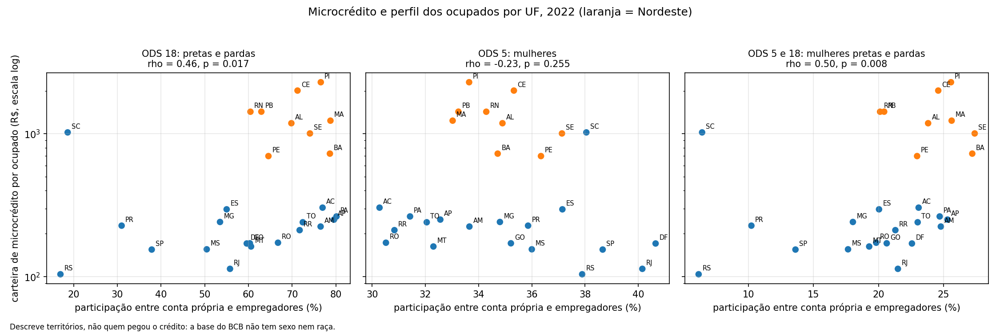

# Microcrédito, gênero e raça: análise territorial para as ODS 5 e 18

Tema 05: acesso a microcrédito e inclusão financeira regional. Análise feita em 05/11/2026 e ampliada em 15/11/2026 com o cruzamento de sexo e raça juntos.

## O que esta análise é e o que ela não é

A base de microcrédito do SCR.data não tem sexo, gênero, cor ou raça. Nenhum desses atributos foi atribuído a operação de crédito nenhuma, e não existe junção entre pessoas: o menor nível dos nossos dados é a soma por UF, tipo de cliente, modalidade e mês.

O que fazemos é comparar dois indicadores por estado: o microcrédito, que vem do Banco Central, e o perfil de quem trabalha por conta própria ou como empregador, que vem do IBGE. A unidade de análise é a UF, e não a pessoa.

> Ressalva obrigatória. Concluir algo sobre pessoas a partir de médias por estado é falácia ecológica. Se um estado com muitas pessoas pretas e pardas tem muito microcrédito, isso não significa que pessoas pretas e pardas pegaram esse crédito. A análise descreve territórios, não tomadores.

Essa ressalva tem que aparecer no relatório e no dashboard, com essas palavras.

## Como foi feito

Microcrédito (nosso banco). Para cada UF, a carteira ativa média dos 12 meses de 2022, somando PF e PJ. Usamos a média porque carteira é um saldo, e somar saldos de meses diferentes não quer dizer nada. A taxa de inadimplência por UF é ponderada pela carteira, nunca uma média simples das taxas.

Perfil demográfico (IBGE). Censo 2022, tabela SIDRA 10261: pessoas de 14 anos ou mais ocupadas como empregador (com pelo menos um empregado) ou conta própria (sem empregados). Dessa tabela saem três indicadores por UF:

- participação de mulheres;
- participação de pessoas pretas e pardas;
- participação de mulheres pretas e pardas, que usa sexo e raça cruzados (o `analise/baixar_ibge.py` busca isso direto da API).

Normalização. Dividimos a carteira pelo número de ocupados por conta própria e empregadores da UF, para não medir só o tamanho da economia do estado. O resultado é "reais de carteira por pessoa ocupada por conta própria ou como empregadora".

Estatística. Correlação de postos de Spearman, porque a carteira por pessoa é muito desigual (de R$ 104 a R$ 2.297). Com 27 UFs o poder estatístico é baixo, então o valor de p serve para calibrar a leitura e não para decidir nada.

O ano é 2022, o do Censo, para que o numerador e o denominador sejam do mesmo período. Julho/2026 entra como checagem.

Para repetir: `python analise/baixar_ibge.py` e depois `python analise/ods_cruzamento.py`.

## Resultados

Correlações de Spearman com 27 UFs:

| Relação | ρ | p |
|---|---:|---:|
| ODS 5: mulheres e carteira por pessoa (2022) | −0,227 | 0,255 |
| ODS 5: mulheres e inadimplência (2022) | 0,133 | 0,508 |
| ODS 18: pretas e pardas e carteira por pessoa (2022) | 0,455 | 0,017 |
| ODS 18: pretas e pardas e inadimplência (2022) | −0,218 | 0,275 |
| ODS 5 e 18: mulheres pretas e pardas e carteira por pessoa (2022) | 0,501 | 0,008 |
| ODS 5 e 18: mulheres pretas e pardas e inadimplência (2022) | −0,261 | 0,189 |
| Controle: carteira por pessoa e inadimplência (2022) | −0,871 | menor que 0,0001 |
| Checagem: mulheres e carteira por pessoa (jul/2026) | −0,155 | 0,440 |
| Checagem: pretas e pardas e carteira por pessoa (jul/2026) | 0,370 | 0,058 |

Sem as 9 UFs do Nordeste (18 UFs):

| Relação | ρ | p |
|---|---:|---:|
| Pretas e pardas e carteira por pessoa | 0,358 | 0,145 |
| Mulheres e carteira por pessoa | −0,410 | 0,091 |
| Mulheres pretas e pardas e carteira por pessoa | 0,319 | 0,197 |

Medianas por região em 2022:

| Região | UFs | Carteira por pessoa | Inadimplência | Mulheres | Pretas e pardas | Mulheres pretas e pardas |
|---|---:|---:|---:|---:|---:|---:|
| Nordeste | 9 | R$ 1.236 | 6,1% | 34,7% | 71,2% | 24,6% |
| Norte | 7 | R$ 240 | 12,8% | 31,4% | 76,5% | 23,1% |
| Sul | 3 | R$ 228 | 11,5% | 37,9% | 18,6% | 6,4% |
| Sudeste | 4 | R$ 198 | 12,9% | 37,9% | 54,3% | 19,0% |
| Centro-Oeste | 4 | R$ 167 | 14,5% | 35,6% | 60,0% | 20,0% |

A tabela completa por UF está em `docs/evidencias/ods_cruzamento_uf.csv`.

## O que os resultados querem dizer

### ODS 18 e ODS 5 e 18 juntas: tem associação, mas é sobre onde a oferta está

Estados com mais pessoas pretas e pardas entre os conta própria e empregadores têm mais carteira por pessoa (ρ = 0,455). Com as mulheres pretas e pardas, a relação é um pouco mais forte (ρ = 0,501, p = 0,008).

Antes de ler isso como inclusão, testamos a explicação mais óbvia, e ela se confirma: as 9 UFs do Nordeste ficam com 62,1% de toda a carteira de microcrédito do país em 2022, com mediana de R$ 1.236 por pessoa, contra R$ 167 a R$ 240 nas outras regiões. O Nordeste também tem alta participação de pessoas pretas e pardas. As duas variáveis sobem juntas porque o Nordeste é alto nas duas.

Sem o Nordeste, as duas relações perdem significância (ρ = 0,358 com p = 0,145 para pretas e pardas, e ρ = 0,319 com p = 0,197 para mulheres pretas e pardas). Então o que a correlação mostra é a concentração regional da oferta, e não o acesso de um grupo. Por que o Nordeste concentra tanto pode ter a ver com programas de microcrédito de alcance regional, mas isso é hipótese: a nossa base não identifica instituição nem programa.

O gráfico mostra contraexemplos. Santa Catarina tem só 18,6% de pretas e pardas (6,4% de mulheres pretas e pardas) e mesmo assim R$ 1.023 por pessoa, com 9,9% da carteira nacional. O Rio de Janeiro tem 55,8% de pretas e pardas e só R$ 113 por pessoa.

### ODS 5: sem associação detectável

A correlação com a participação de mulheres é fraca e não significativa (ρ = −0,227, p = 0,255), e continua assim em julho/2026. Isso é um resultado, e não uma falha. O que dá para dizer é que, com estes dados e no nível de estado, não há sinal de relação entre a presença de mulheres entre os pequenos empreendedores e o volume de microcrédito. Não dá para dizer que não existe desigualdade de gênero no acesso, porque a base não tem sexo para observá-la.

Também ajuda saber que esse indicador varia pouco: de 30,3% (Acre) a 40,7% (Distrito Federal). A participação de pretas e pardas vai de 17,0% (Rio Grande do Sul) a 80,2% (Pará). Faixa estreita dificulta achar qualquer relação.

### O achado mais forte não é de nenhuma das duas ODS

A relação mais nítida é entre a densidade de microcrédito e a inadimplência (ρ = −0,871, p menor que 0,0001): onde há mais microcrédito por pessoa, a inadimplência é bem menor. O Piauí tem R$ 2.297 por pessoa e 5,9% de inadimplência, e o Rio de Janeiro tem R$ 113 e 22,4%.

Cuidado ao interpretar. Pode ser que operações em escala, com metodologia própria, inadimplam menos. Pode ser também que carteiras pequenas sejam resíduos com mais casos problemáticos. A correlação é forte, mas a explicação não está nos dados.

## Limitações

1. Falácia ecológica. Está no topo por ser a mais importante.
2. Universos diferentes. A carteira soma PF e PJ, e o denominador do IBGE conta pessoas ocupadas por conta própria ou como empregadoras. São próximos, mas não idênticos.
3. Só 27 observações. Um estado atípico muda o resultado.
4. O Censo só tem 2022, então não dá para ver o perfil mudando ao longo dos anos.
5. Correlação não é causa. Nada aqui mede efeito de política.
6. O Nordeste confunde a leitura, e com 27 estados não dá para montar um modelo com controles.
7. Os números cruzados de sexo e raça vêm arredondados pelo IBGE e diferem em até 0,1% dos totais por sexo ou por raça.
8. Não usamos a quantidade de operações, porque 1.085 das 7.081 linhas têm valor negativo e o BCB não explica o critério.

## Fontes

- Banco Central do Brasil, SCR.data versão 2, submodalidade Microcrédito, 2021 a 2026. Metodologia em <https://www.bcb.gov.br/pda/desig/metodologia_versao2.pdf>.
- IBGE, Censo Demográfico 2022, amostra de trabalho e rendimento. Tabela SIDRA 10261, em <https://sidra.ibge.gov.br/tabela/10261>.
- ODS 18 (igualdade étnico-racial): iniciativa brasileira proposta na ONU em 2023, com metas definidas pela Comissão Nacional para os ODS e coordenada pelo Ministério da Igualdade Racial. Não faz parte dos 17 ODS globais da Agenda 2030.
